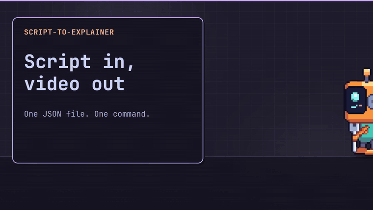

# script-to-explainer



Turn a JSON script into a narrated 1080p explainer video, rendered locally with one command.

Full example video (720p, 51 s, 2 MB): [docs/demo-720p.mp4](docs/demo-720p.mp4). The 1080p version is what `render` produces from `examples/demo.json`.

## Who it is for

Short product demo videos, tutorials, release walkthroughs and onboarding clips where you want a narrated, animated video from text you can edit and version, without a video editor, a cloud service or a recording session.
Bit, a small pixel-art robot, presents your slides: he walks on and off the stage, points at the slide, waves, shrugs and celebrates on the words you choose, and his mouth follows the voice. One card morphs between slides, text springs in, key words get highlighted, a camera drifts and zooms, and captions fill word by word.

No cloud, no account: the voice (Kokoro) runs on your machine. Python directs (voice, word timing, stage plan); an HTML/GSAP composition drawn by [HyperFrames](https://github.com/heygen-com/hyperframes) renders the picture.

## Requirements

- Python 3.10 or newer
- Node.js 22 or newer (for the motion layer; the tools are installed locally by `npm install`, nothing global)
- [ffmpeg](https://ffmpeg.org/download.html) on your PATH
- About 350 MB of disk for the voice model (downloaded once, on the first render)

## Quick start

```bash
python -m venv .venv
.venv/bin/pip install -e .            # Windows: .venv\Scripts\pip install -e .
npm install --ignore-scripts          # HyperFrames 0.8.174 and GSAP 3.14.2, pinned in package-lock.json
.venv/bin/python -m explainer render examples/demo.json -o out/demo.mp4
```

You get `out/demo.mp4` (1920x1080, 30 fps, about 51 s), `out/demo.srt` (captions), `out/demo.stage.json` and `out/demo.stage.report.json` (what the stage planner decided, one row per cue).
Check a script without rendering: `python -m explainer validate examples/demo.json`.
Look at the planned stage without rendering: add `--preview` (writes the composition to `out/hf/`).
Check a finished video against the acceptance criteria: `python -m explainer check out/demo --table out/demo.table.md`.
No Node.js? `--renderer pillow` draws a simpler video (no motion layer, no walking) with Pillow only.

Optional, better word timing: `pip install -e ".[align]"` (faster-whisper, runs locally). With `"align": "auto"` in the script it re-times each word from the audio; otherwise timing is proportional to syllables (good to about 250 ms).

## The script format

```json
{
  "title": "My video",
  "align": "auto",
  "voice": { "engine": "kokoro", "voice": "am_fenrir", "speed": 1.0, "style": "expressive" },
  "pauses": { "comma": 0.2, "period": 0.45, "ellipsis": 0.5 },
  "scenes": [
    {
      "lead": 1.8,
      "say": "Hi... I'm Bit. Welcome!",
      "emotion": "happy",
      "cues": [
        { "on": "start", "action": "enter", "from": "off", "x": "R", "face": "camera" },
        { "on": "Hi", "action": "wave", "hold": 1.3 },
        { "on": "Welcome", "action": "walk_to", "x": "H" }
      ],
      "camera": [ { "on": "Hi", "view": "bit", "zoom": 1.04 } ],
      "emph": [ { "on": "Welcome", "target": "title", "style": "mark" } ],
      "slide": { "type": "title", "kicker": "Intro", "title": "Hello", "subtitle": "Nice to meet you" }
    }
  ]
}
```

| Field | Values |
| --- | --- |
| `emotion` | `neutral`, `happy`, `thinking`, `pointing` (mood: shows while he talks) |
| `slide.type` | `title` (kicker, title, subtitle), `bullets` (title, items), `highlight` (title, highlight, subtitle) |
| `pause_after` | seconds of silence after the scene, 0 to 10 (default 0.5) |
| `lead` | seconds of silence before the narration of the scene (default 0.5) |
| `speed` | speech speed factor for the scene, 0.5 to 2 |
| `voice` | engine plus options: `voice` (a name, or a mix such as `"am_puck:0.7,am_fenrir:0.3"`), `speed`, `style` (`expressive` slows emphatic clauses: CAPS, `!`, `...`; `plain` does not) |
| `pauses` | silence after a clause by punctuation, seconds: `comma`, `semicolon`, `colon`, `dash`, `ellipsis`, `period`, `question`, `exclaim` |
| `align` | `proportional` (default), `whisper` or `auto` (whisper if installed) |

Narration is English. It is spoken clause by clause, so pauses and speed follow the punctuation you write.

### Cues: what Bit does on which word

A cue is anchored on a word of the narration: `"on"` takes a text (first occurrence), `"start"`, `"end"`, or use `"word": N` (index) or `"at": seconds`. A pose starts 200 ms before its word so it peaks on the word.

| Action | What happens |
| --- | --- |
| `wave`, `bow_wave`, `point_slide`, `point_down`, `think_chin`, `celebrate`, `explain_open`, `shrug`, `look_slide`, `happy_beat`, `surprise` | a pose (`hold` seconds, `target` makes the pointer ring go there) |
| `enter`, `walk_to`, `exit`, `turn` | stage: `x` is a station (`off`, `R`, `H`, `M`, `N`) or a number between 1090 and 1900, `face` is `camera` or `slide` |

Without a cue the planner adds gestures by rule (greeting, question, goodbye, "this/here", numbers, long stretches). A walk that cannot be done before the next gesture is an error in `stage.report.json`, never a late gesture.

`camera`: `{ "on", "view": "wide|slide|bit|caption", "zoom" }`. `emph`: `{ "on", "target": "title|subtitle|highlight|item:N|word:text", "style": "mark|pop" }`. `reveal`: `{ "item", "on" }` (when a bullet appears). `count`: `{ "item" or "target": "badge", "from", "to", "on", "ms" }` (a number that counts up). The `stage` block of `examples/demo.json` shows every tunable (stations, walking speed, springs, camera views, card shapes, background).

## Voices (swappable engine)

| Engine | Notes |
| --- | --- |
| `kokoro` (default) | Local and free. Default voice `am_fenrir`; also `am_puck`, `am_adam`, `af_heart`, `bf_emma`, ... Mix two with `"am_puck:0.7,am_fenrir:0.3"`. |
| `azure` | Optional. Set `AZURE_SPEECH_KEY` and `AZURE_SPEECH_REGION`, then use `--engine azure` or `"engine": "azure"` in the script, e.g. `"voice": "en-US-AvaMultilingualNeural"`. |

Choose at render time: `python -m explainer render demo.json --engine azure`, or override `--voice`, `--speed`, `--pause-comma`, `--pause-period`.
To add another engine, implement `synthesize(text) -> (samples, sample_rate)` in `src/explainer/tts/` and register it in `tts/__init__.py`.
Set `EXPLAINER_MODELS` to keep the Kokoro model files somewhere else (default: `./models`).

## Limitations

- Narration is English only for now (the default Kokoro voices); other languages need another engine.
- Bit is the only character, and the slides are the three built-in types. Custom layouts mean editing `src/explainer/hf/`.
- Word timing without the optional `align` extra is estimated (about 250 ms error), so a gesture can land slightly off its word.
- A 1080p render of a one-minute script takes a few minutes on a laptop CPU; the first run also downloads the voice model.
- Tested on Windows; Linux and macOS should work but have not been exercised.

## Tests

```bash
.venv/bin/pip install pytest
.venv/bin/python -m pytest
```

`python -m explainer check out/demo` measures a finished video against 17 acceptance criteria (stage, sync, motion, format) and writes `out/demo.checks.json`.

## Credits and licenses

- Code: MIT, see `LICENSE`.
- Font: JetBrains Mono, SIL Open Font License 1.1 (`src/explainer/assets/fonts/OFL.txt`).
- Voice: [Kokoro](https://huggingface.co/hexgrad/Kokoro-82M) through [kokoro-onnx](https://github.com/thewh1teagle/kokoro-onnx), both Apache 2.0. Model files are downloaded, not stored in this repository.
- Bit (pixel art): original artwork for this project, MIT like the code.
- Motion layer: [HyperFrames](https://github.com/heygen-com/hyperframes) 0.8.174 (Apache 2.0) renders the HTML composition and [GSAP](https://gsap.com) 3.14.2 is the timeline clock (GSAP standard license). Both are installed by `npm install`, not stored in this repository.
- Slide colors follow the Catppuccin Mocha palette (MIT).


